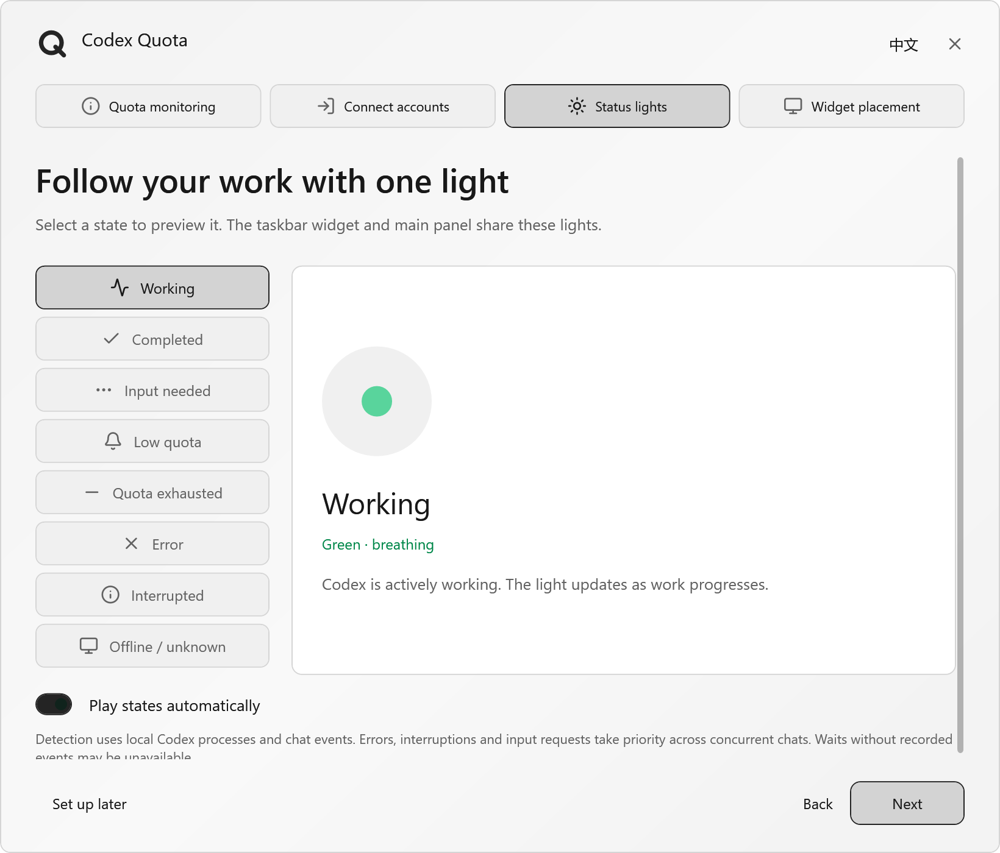
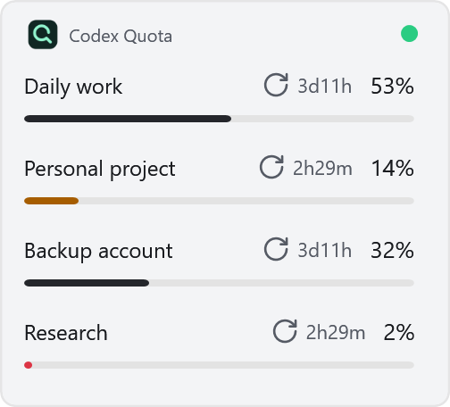
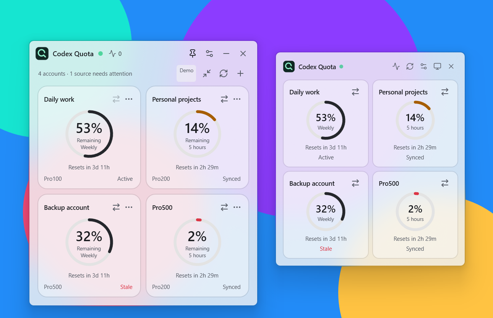
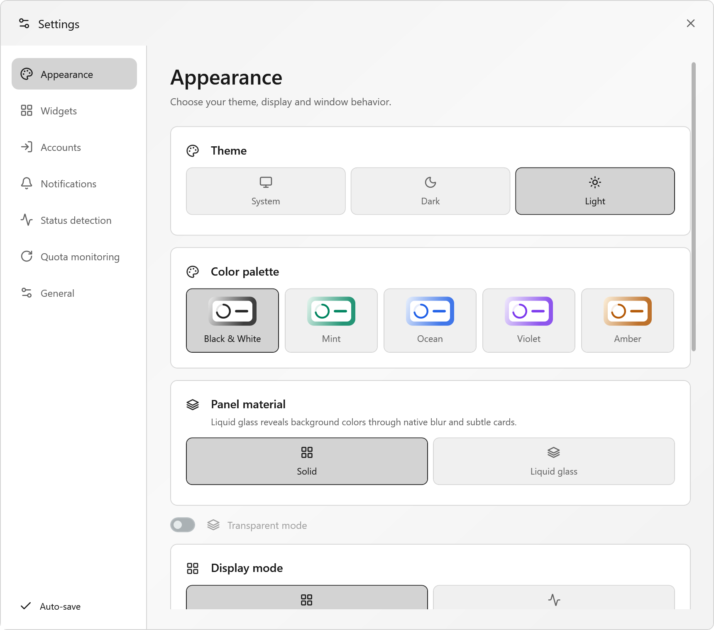

#  CodexQuota

[简体中文](README.md) · **English**

Monitor Codex account quotas, reset timers and session issues from one Windows app. Connect accounts with **one-click CC Switch import** or **native Codex sign-in**.

**[Download the 2.3 release](https://github.com/IcebearHound/CodexQuota/releases/tag/v2.3.0)** · [Quick start](#quick-start) · [Changelog](CHANGELOG.md)

Screenshots use demo data and include UI updates from the current development branch. Use the link above for the stable release.

| Compact widget (main window) | Taskbar widget and expanded panel |
| --- | --- |
|  |  |

- Track short-term and weekly reset windows independently, with same-email accounts grouped together.
- Choose ring or status-bar mode separately for the compact main window and taskbar widget. The expanded taskbar panel follows the widget's layout.
- Open an affected chat, ignore one occurrence or ignore all current session issues.

| Multi-account dashboard | Session issues |
| --- | --- |
|  | <br>See chat titles, issue types and timestamps.<br>Use the arrow to open a chat or the ignore icon to dismiss an occurrence. |

## Act on session issues

Open the issue list from the main window, a status light or the taskbar menu. Review errors and interruptions, ignore a single occurrence or choose **Ignore all**. The list refreshes automatically, filters out archived chats and attached history snapshots, and clears old interruptions when work resumes. A new issue in the same chat triggers a fresh alert. Input requests, errors, interruptions and exhausted quotas appear in a compact notification window.

## Quick start

1. Download the Windows x64 portable ZIP, extract it and run `CodexQuota.exe`. The .NET runtime is included. Usage is queried through your locally installed Codex application.
2. Follow the first-run interactive guide to connect accounts, explore quota examples and enable the taskbar widget.
3. Reopen the guide from **Settings → General → Guide and manual**. You can switch chapters freely.

### CC Switch import and native sign-in

- Choose **Import from CC Switch** to scan existing local Codex accounts, then confirm to sync credentials and account names.
- Choose **Sign in with Codex** to authenticate through the official browser page. Added accounts use separate credential directories, and you can repeat the flow to connect more accounts.


### Quota and status walkthrough

The quota example switches between remaining and used quota and explains independent reset windows. Select a status example to explore working, completed, waiting for input, low quota, exhausted, error, interrupted and offline signals.

<details>
<summary>View the quota and status guide</summary>




</details>

## Taskbar and compact views

Click the taskbar widget once to pin its account panel open and again to close it. Hover for a temporary preview. Its context menu changes the layout of both the widget and the expanded panel without changing the main window. See the [ring panel](docs/images/taskbar-ring-panel-en.png) or the [single-column status-bar panel](docs/images/taskbar-preview-en.png).


Compact mode shows account names, quotas, reset timers and a live status light that opens session issues. Double-click blank space to switch between compact and full mode; buttons, account text and the light do not trigger this shortcut. Esc and the context menu also restore the full interface. Drag near a screen’s work-area edge or corner to snap the compact panel without covering the taskbar; drag away to release.

| Compact ring | Compact status bar |
| --- | --- |
|  |  |

## Make it fit your desktop

**Black & White** is now the default palette and appears first. It follows Windows light and dark mode. Mint, Ocean, Violet and Amber are also available, along with manual light/dark controls. Upgrades preserve your selected palette.

| Black & White · Light | Black & White · Dark |
| --- | --- |
|  |  |

Liquid glass uses native blur and a neutral frost to soften background colors and keep text readable. It appears on first open without another click. Solid colors are used when the system backdrop is unavailable or the window is embedded in the desktop.



<details>
<summary>Appearance, startup and other options</summary>



Enable **Start with Windows** in **Settings → General → Window behavior** to launch in the tray after sign-in. Quota and reset-credit alerts, Chinese and English, account renaming and privacy display are supported.


</details>

## In-place updates

Open **Settings → General → Version and updates** to check stable releases. Automatic checks run at most once per day. Downloading and restarting require confirmation. After verifying the GitHub-provided SHA-256 digest, the app restarts briefly, replaces files in its original folder and refreshes the existing startup path. Failed startup checks automatically restore the previous version.


Self-updating starts with the **complete 2.3 portable ZIP**. Users of 2.2 or old Win+W packages need to download this version once. See [update architecture and recovery](docs/updates.md#english).

## Data and upgrades

Accounts and settings are stored in `%LOCALAPPDATA%\CodexQuotaWidget`. Usage is queried through the local Codex app-server. Exit the previous version before starting an upgrade.

**Starting with 2.3, Windows Win+W Widgets board support and its extension package are discontinued. The taskbar widget remains supported.** First verify and back up your accounts and settings in the portable build, then remove the old package from Windows Installed apps. If data is missing, keep the old package until backup and migration are complete. Keep the data directory above.

<details>
<summary>Build and verification</summary>

Requires Windows and the .NET 10 SDK. `global.json` specifies SDK 10.0.100 and allows newer feature bands.

```powershell
dotnet build Quota.Desktop -c Release
dotnet run --project Quota.Tests -c Release
dotnet run --project Quota.Presentation.Tests -c Release
```

UI regression checks require an interactive Windows desktop and an isolated data directory.

```powershell
$fixture = Join-Path ([IO.Path]::GetTempPath()) ('CodexQuota-' + [guid]::NewGuid().ToString('N'))
dotnet run --project Quota.Presentation.Tests -c Release -- --guide-smoke --demo --guide --data-dir $fixture
```

Publish a self-contained single-file build.

```powershell
./Publish-Release.ps1 -OutputDirectory artifacts/release
```

The release script packages the self-contained single-file app, licenses and `install-files.json` for future in-place updates. The updater reuses the app executable instead of shipping another .NET runtime.

</details>

## License

[MIT License](LICENSE). The Lucide license is in [Assets/lucide/LICENSE](Quota.Desktop/Assets/lucide/LICENSE). Portable builds include .NET runtime licenses and third-party notices.
