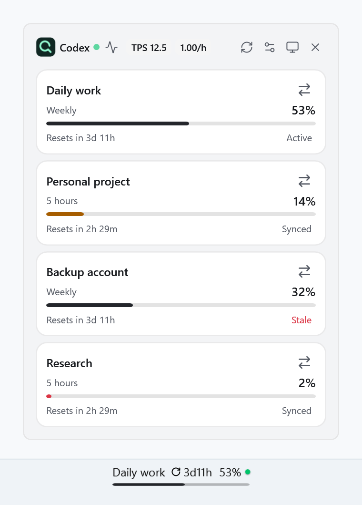
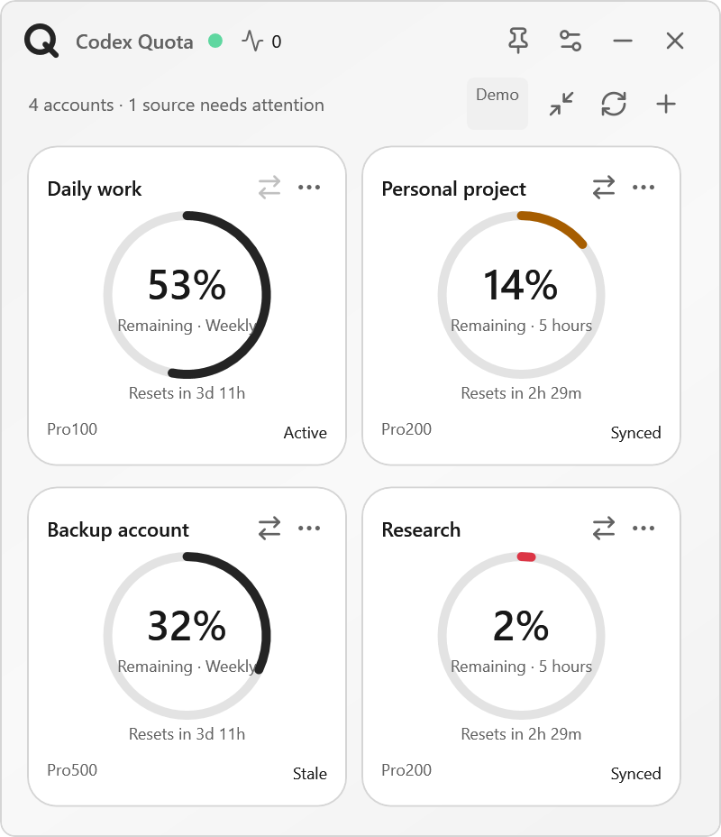
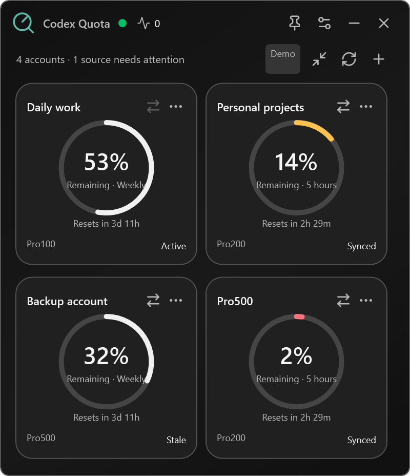
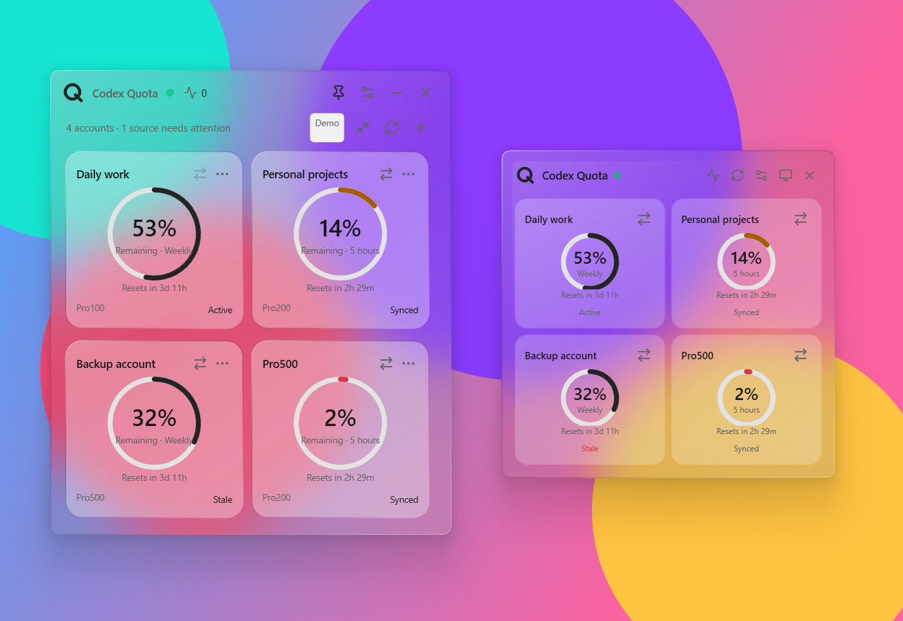
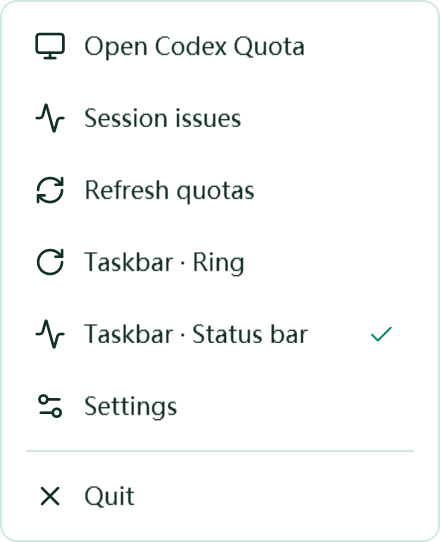

# CodexQuota

[简体中文](README.md) · **English**

Monitor Codex account quotas, reset timers and session issues from one Windows app. Connect accounts with **one-click CC Switch import** or **native Codex sign-in**.

**[Download the 2.2 release](https://github.com/IcebearHound/CodexQuota/releases/tag/v2.2.0)** · [Quick start](#quick-start) · [Changelog](CHANGELOG.md)

Actual 2.2 screenshots with demo data. All use the light theme except the dark-theme comparison.

| Compact widget (main window) | Taskbar widget and expanded panel |
| --- | --- |
|  |  |

- Track short-term and weekly reset windows independently, with same-email accounts grouped together.
- Use compact mode in the main window, with separate ring and status-bar layouts for the main panel and taskbar.
- Open an affected chat, ignore one occurrence or ignore all current session issues.

| Multi-account dashboard | Session issues |
| --- | --- |
|  | <br>See chat titles, issue types and timestamps.<br>Use the arrow to open a chat or the ignore icon to dismiss an occurrence. |

## Act on session issues

Open the issue list from the main window, a status light or the taskbar menu. Review errors and interruptions, ignore a single occurrence or choose **Ignore all**. The list refreshes automatically, filters out archived chats and attached history snapshots, and clears old interruptions when work resumes. A new issue in the same chat triggers a fresh alert. Input requests, errors, interruptions and exhausted quotas appear in a compact notification window.

## Quick start

1. Download the Windows x64 portable ZIP, extract it and run `CodexQuota.exe`. The .NET runtime is included. Usage is queried through your locally installed Codex application.
2. Follow the first-run interactive guide to connect accounts, explore quota examples and enable the taskbar widget.
3. Reopen the guide from **Settings → General → Guide and manual**. You can switch chapters freely.

### CC Switch import and native sign-in

- Choose **Import from CC Switch** to scan existing local Codex accounts, then confirm to sync credentials and account names.
- Choose **Sign in with Codex** to authenticate through the official browser page. Added accounts use separate credential directories, and you can repeat the flow to connect more accounts.


### Quota and status walkthrough

The quota example switches between remaining and used quota and explains independent reset windows. Select a status example to explore working, completed, waiting for input, low quota, exhausted, error, interrupted and offline signals.

<details>
<summary>View the quota and status guide</summary>


</details>

## Taskbar and compact views

Click the taskbar widget once to pin its account panel open and again to close it. Hover for a temporary preview. Its context menu switches between ring and status-bar layouts. The taskbar and main window save their layout preferences separately.


Compact mode shows account names, quotas and reset timers. Double-click, press Esc or use the context menu to restore the full interface.

| Compact ring | Compact status bar |
| --- | --- |
|  |  |

## Make it fit your desktop

**Black & White** is now the default palette and appears first. It follows Windows light and dark mode. Mint, Ocean, Violet and Amber are also available, along with manual light/dark controls. Upgrades preserve your selected palette.

| Black & White · Light | Black & White · Dark |
| --- | --- |
|  |  |

Liquid glass uses Windows 11 native blur, light cards and soft edges, without the raised inner outline. Enable **Transparent mode** in **Settings → Appearance** for more background color while keeping readable text. This option is available only with liquid glass. Solid colors are used when the system backdrop is unavailable or the window is embedded in the desktop.



<details>
<summary>Appearance, startup and other options</summary>


Enable **Start with Windows** in **Settings → General → Window behavior** to launch in the tray after sign-in. Quota and reset-credit alerts, Chinese and English, account renaming and privacy display are supported.




</details>

## Data and upgrades

Accounts and settings are stored in `%LOCALAPPDATA%\CodexQuotaWidget`. Usage is queried through the local Codex app-server. Exit the previous version before starting an upgrade.

The optional [Windows Win+W Widgets package](docs/windows-widgets.md#windows-widgets-board-optional) combines the desktop app and provider into one Start entry, with startup controlled by the main app. It uses unsigned developer registration. The ordinary taskbar widget works directly from the portable build.

<details>
<summary>Build and verification</summary>

Requires Windows and the .NET 10 SDK. `global.json` specifies SDK 10.0.100 and allows newer feature bands.

```powershell
dotnet build Quota.Desktop -c Release
dotnet run --project Quota.Tests -c Release
dotnet run --project Quota.Presentation.Tests -c Release
```

UI regression checks require an interactive Windows desktop and an isolated data directory.

```powershell
$fixture = Join-Path ([IO.Path]::GetTempPath()) ('CodexQuota-' + [guid]::NewGuid().ToString('N'))
dotnet run --project Quota.Presentation.Tests -c Release -- --guide-smoke --demo --guide --data-dir $fixture
```

Publish a self-contained single-file build.

```powershell
dotnet publish Quota.Desktop -c Release -r win-x64 --self-contained true -p:PublishSingleFile=true -p:EnableCompressionInSingleFile=true -p:IncludeNativeLibrariesForSelfExtract=true -p:DebugType=None -o artifacts/win-x64
```

The source includes `Quota.WidgetProvider` and `Publish-Widgets.ps1` for a Windows Widgets Board extension under the same application entry. See [build and registration instructions](docs/windows-widgets.md#windows-widgets-board-optional).

</details>

## License

[MIT License](LICENSE). The Lucide license is in [Assets/lucide/LICENSE](Quota.Desktop/Assets/lucide/LICENSE). Portable builds include .NET runtime licenses and third-party notices.
