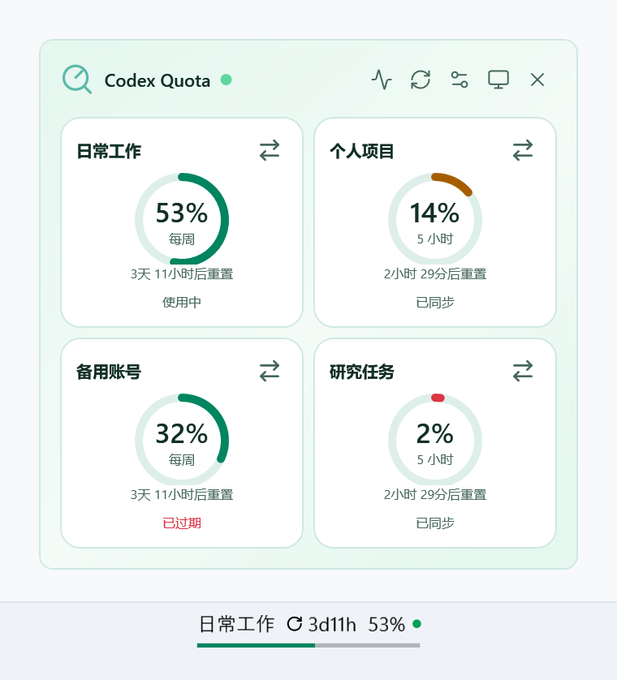
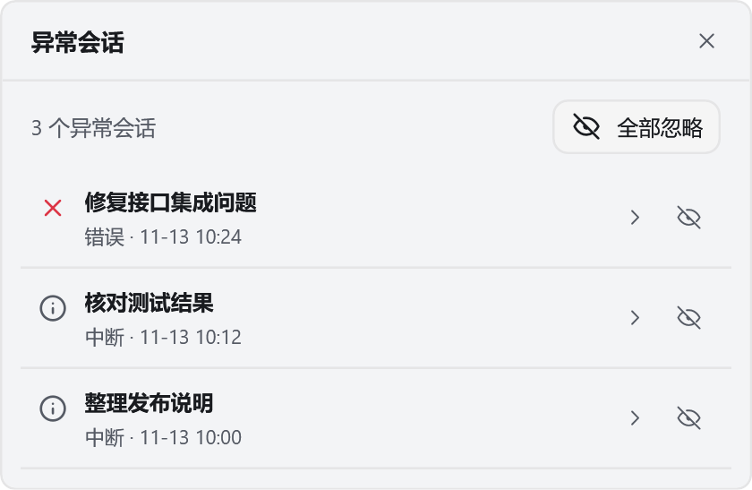
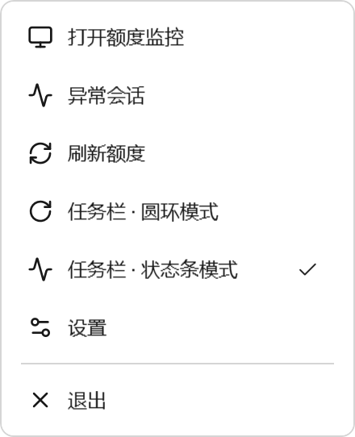
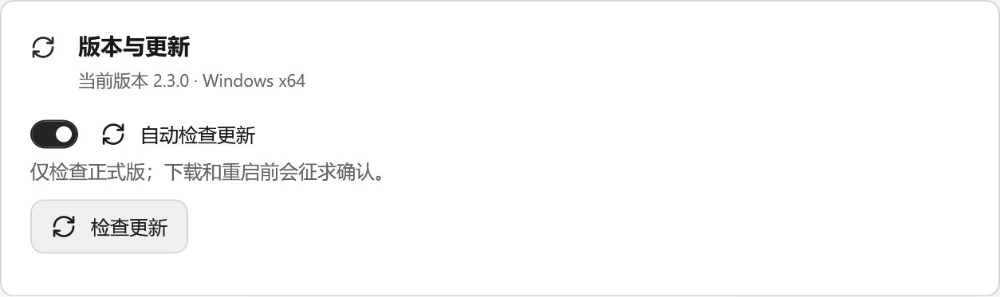

#  CodexQuota

**简体中文** · [English](README.en.md)

在 Windows 上集中查看 Codex 的多账号额度、重置时间和异常会话。支持 **CC Switch 一键导入账号**和 **Codex 原生登录**。

**[下载 4.1.0](https://github.com/IcebearHound/CodexQuota/releases/tag/v4.1.0)** · [快速开始](#快速开始) · [更新记录](CHANGELOG.md)

以下界面截图使用演示数据。

| 精简小组件（主面板） | 任务栏小组件与展开面板 |
| --- | --- |
|  |  |

- 短期与每周额度独立计时，同邮箱账号自动合并。
- 主面板支持精简模式。主面板与任务栏可分别选择圆环或状态条，任务栏展开面板跟随任务栏组件的选择。
- 异常会话可直接打开、单条忽略或全部忽略。

| 多账号主面板 | 异常会话列表 |
| --- | --- |
|  | <br>查看会话名称、异常类型和发生时间。<br>右侧箭头打开会话，忽略图标处理本次异常。 |

## 异常会话也有处理入口

悬停状态灯可区分当前账号额度读取异常和会话错误。额度读取异常会显示原因；会话错误可点击状态灯打开异常列表。两者同时发生时会分别列出。

从主面板、状态灯或任务栏菜单打开异常列表，查看错误与中断记录。支持单条忽略和右上角的「全部忽略」。列表自动刷新，过滤已归档会话、附属历史快照和内部子代理。会话恢复后自动移除旧中断，同一会话出现新的异常时会再次提醒。需要输入、错误/中断和额度耗尽时显示独立的小通知浮窗。

## 快速开始

1. 如果发布页提供 `-setup.exe`，可直接运行。安装向导默认使用 `D:\Program Files\CodexQuota`；选择其他上级目录时会自动追加 `CodexQuota` 子目录。也可以下载 Windows x64 便携 ZIP，完整解压后运行 `CodexQuota.exe`。两种方式都内置 .NET 运行时；额度查询使用本机已安装的 Codex 程序。
2. 安装完成时可直接启动导览。按导览连接账号、放置任务栏小组件，按需开启「开机启动」，让监控在登录 Windows 时从托盘运行。
3. 之后可从「设置 → 通用 → 使用导览与说明书」再次打开导览，章节可自由切换。

### CC Switch 导入与原生登录

- 点击 **从 CC Switch 导入**，扫描本机已有的 Codex 账号，确认后同步认证和账号名称。
- 点击 **原生登录**，通过 Codex 官方浏览器页面完成认证。添加的账号使用独立认证目录，可重复连接多个账号。


### 额度耗尽时自动切换

连接备用账号后，可在首次导览的「连接账号」页或「设置 → 账号」开启 **额度耗尽时自动切换账号**（默认关闭）。额度刷新确认当前账号的 Codex 额度耗尽后，会复查备用账号；找不到仍有额度的账号时不会切换。运行中的桌面端会先正常退出再切换；仅有命令行 Codex 在运行时不会更改认证。

CodexQuota 发起重启后会打开最近运行的会话。自动切换时，如果没有正在运行的会话，也会查找最近因额度限制中断的会话。未完成的任务可在原会话中继续，指令不会自动重发。

### 监控 OpenAI API 赠送额度

在首次导览的「API 赠送额度」页，或「设置 → 额度监测」，开启 **监控 API 赠送额度**（默认关闭），然后点击「连接 API 账号」。登录 OpenAI Platform 后，应用自动读取当前 API 组织并返回额度面板。每个组织只显示一个「API · 账号名」条目。查看额度无需 API Key 或付款信息；网页登录状态仅保存在本机的 Microsoft Edge WebView2 配置中。

- **用赠送额度登录 Codex**：在「API · 账号名」卡片点击「切换账号」，首次切换时粘贴该组织下的项目 API Key，然后重启 Codex。可从卡片的「⋯ → 设置 Codex API Key」更换密钥，或从已连接的 ChatGPT 账号切换回订阅登录。切换使用 Codex 的本地 `auth.json`；API 账号仅支持手动切换。请求按该项目计费，可用赠送额度抵扣，用完后可能产生费用。

- 读取 [OpenAI Platform 账单概览](https://platform.openai.com/settings/organization/billing/overview) 的赠送余额和最早到期日。页面只给出日期时，不推算具体到期时刻；页面没有单列赠送余额时，不把充值或钱包余额算进去。
- 在 API 账号的「⋯ → 每周期赠送额度」可设置进度环的 100% 刻度，例如 Pro100 设为 US$100。余额仍使用账单实值；首笔按比例少发放的差额不会显示为已用。
- 复用额度偏低、用尽和新发放提醒。「设置 → 通知」可单独关闭 API 到期提醒；低额度百分比需要能核对原始发放金额。关闭监控会停止查询和提醒，但保留连接。
- 在「设置 → 小组件 → 显示 API 额度」分别控制完整主面板、精简小组件、任务栏常驻组件和展开面板。任务栏有空位时，API 余额和到期日会显示在 Codex 旁边；在 API 区域滚动只切换显示的 API 账号。空位不足时仍可在展开面板查看（需启用该面板的 API 显示）。

### 额度与状态导览

额度示例可切换剩余与已用口径，展示各窗口的独立重置时间。状态章节可点击预览执行、完成、等待输入、低额度、耗尽、错误、中断和离线信号。

检测到网络或 Windows 系统代理设置变化时，未同步的账号会自动重试，无需等到下一次定时刷新。有上次额度可显示时，只有读取超时才标记「已过期」；其他失败会显示「需处理」和具体原因。非当前账号的过期额度不点亮状态灯。

顶栏的状态心跳右侧默认显示两项速率。可在导览的「额度监测」，或「设置 → 额度监测」分别关闭：

- **本机输出速率（TPS）**：主面板顶部显示本机 Codex 会话最近 60 秒记录的平均输出 token 数（token/s）。日志批量更新，数值不是模型的实时生成速度。
- **额度消耗速率**：用现有刷新记录计算本机当前账号最紧张的额度窗口近 1 小时的平均速率。刚开始采样时按已有时长计算，悬停可查看实际时长。`2.00/h` 表示平均每小时消耗 2 个百分点；极低的正速率按天显示。Codex 返回整数百分比，读数不变时显示「未见变化」，不代表零消耗。窗口重置或采样不足时显示「—」。

完整主面板、精简小组件和任务栏展开面板都在顶栏显示速率，不在账号卡片上重复。常驻任务栏空间足够时也会显示；浏览其他账号不会改变当前活动账号的消耗速率。

<details>
<summary>查看额度与状态导览界面</summary>


</details>

## 任务栏与精简模式

单击任务栏小组件可固定展开账号面板，再次单击收起。悬停提供临时预览，右键菜单可切换圆环和状态条；展开面板同步切换，主面板不受影响。查看 [圆环面板](docs/images/taskbar-ring-panel.png) 或 [单列状态条面板](docs/images/taskbar-preview.png)。


主面板的精简模式显示账号、额度、重置时间和实时状态灯，点击状态灯可打开异常会话列表。双击空白处可在精简与完整界面间切换，按钮、账号文字和状态灯不会误触切换；Esc 或右键菜单也可返回完整界面。拖动精简面板靠近当前屏幕的工作区边缘或四角时自动吸附，避开任务栏，再次拖动即可移开。

| 精简圆环 | 精简状态条 |
| --- | --- |
|  |  |

## 按习惯调整外观

默认使用「黑白」配色，位于调色板首位，随 Windows 浅色和深色模式切换。还可选择薄荷、海蓝、紫罗兰和琥珀，或手动指定明暗主题。升级会保留已选配色。

| 黑白 · 浅色 | 黑白 · 深色 |
| --- | --- |
|  |  |

液态玻璃使用原生模糊与中性雾面，柔化背景色彩，保留文字对比度。首次打开窗口即可呈现玻璃效果，无需再次点击。系统背景不可用或桌面嵌入模式下使用纯色配色。


<details>
<summary>外观、开机启动与其他选项</summary>


在「设置 → 通用 → 窗口行为」开启「开机启动」后，Codex Quota 由当前用户的 Windows 登录事件触发，直接进入托盘，不弹出主窗口。支持额度与重置卡提醒、中英文、账号重命名和隐私显示。




</details>

## 原地自更新

每天首次打开时在后台检查正式版。发现新版本时，弹窗会显示版本和更新摘要，可选择「更新并重启」或「跳过此版本」。在「设置 → 通用 → 版本与更新」可关闭自动检查或手动检查。更新包通过 GitHub 提供的 SHA-256 校验后，应用短暂重启、原目录替换并刷新已有开机启动路径；新版本启动失败时自动回滚。



自更新从 **2.3 完整便携版**开始支持。2.2 及旧 Win+W 包用户需要先下载本版，之后可在应用内更新。[更新机制与恢复说明](docs/updates.md)。

## 数据与升级

账号和设置保存在 `%LOCALAPPDATA%\CodexQuotaWidget`。Codex 用量通过本机 Codex app-server 查询；API 赠送额度使用单独的 WebView2 登录。升级前退出旧版额度监控，再运行新版。

**2.3 起停止支持 Windows Win+W 内置小组件，不再发布扩展包。任务栏小组件继续保留。** 先在完整便携版中确认账号和设置完整并备份，再从 Windows「已安装的应用」卸载旧包。若数据未出现，保留旧包，先完成数据备份与迁移；不要删除上述数据目录。

<details>
<summary>构建与验证</summary>

需要 Windows 和 .NET 10 SDK。`global.json` 指定 SDK 10.0.100，并允许同系列较新功能版本。

```powershell
dotnet build Quota.Desktop -c Release
dotnet run --project Quota.Tests -c Release
dotnet run --project Quota.Presentation.Tests -c Release
```

实窗回归使用可交互的 Windows 桌面与独立数据目录。

```powershell
$fixture = Join-Path ([IO.Path]::GetTempPath()) ('CodexQuota-' + [guid]::NewGuid().ToString('N'))
dotnet run --project Quota.Presentation.Tests -c Release -- --guide-smoke --demo --guide --data-dir $fixture
```

发布自包含单文件版本。

```powershell
./Publish-Release.ps1 -OutputDirectory artifacts/release
```

发布脚本生成自包含单文件程序、许可与 `install-files.json`，打包为支持后续原地更新的 ZIP。更新器复用程序自身，不额外分发一套 .NET 运行时。

安装版使用同一份发布内容。安装 Inno Setup 6.7.3 或更高版本后，传入 `ISCC.exe` 可同时生成安装程序：

```powershell
./Publish-Release.ps1 -OutputDirectory artifacts/release -InstallerCompiler 'C:/Program Files (x86)/Inno Setup 6/ISCC.exe'
```

</details>

## 许可

[MIT License](LICENSE)。Lucide 图标许可位于 [Assets/lucide/LICENSE](Quota.Desktop/Assets/lucide/LICENSE)，便携版附带 .NET 运行时许可及第三方声明。
