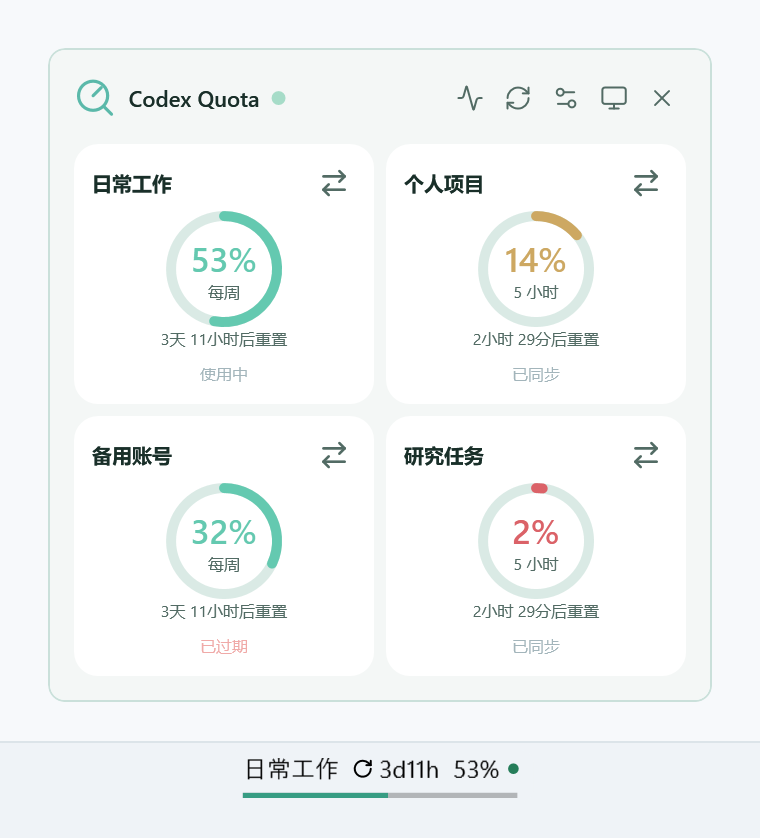

# CodexQuota

**简体中文** · [English](README.en.md)

在 Windows 上集中查看 Codex 的多账号额度、重置时间和异常会话。支持 **CC Switch 一键导入账号**和 **Codex 原生登录**。

**[下载 2.0 正式版](https://github.com/IcebearHound/CodexQuota/releases/tag/v2.0.0)** · [快速开始](#快速开始) · [更新记录](CHANGELOG.md)

以下截图使用浅色主题和演示数据。

| 精简小组件（主面板） | 任务栏小组件与展开面板 |
| --- | --- |
|  |  |

- 短期与每周额度独立计时，同邮箱账号自动合并。
- 主面板支持精简模式，主面板与任务栏可分别选择圆环或状态条。
- 异常会话可直接打开、单条忽略或全部忽略。

| 多账号主面板 | 异常会话列表 |
| --- | --- |
|  | <br>查看会话名称、异常类型和发生时间。<br>右侧箭头打开会话，忽略图标处理本次异常。 |

## 异常会话也有处理入口

从主面板、状态灯或任务栏菜单打开异常列表，查看错误与中断记录。支持单条忽略和右上角的「全部忽略」。列表自动刷新并过滤已归档会话，同一会话出现新的异常时会再次提醒。

## 快速开始

1. 下载 Windows x64 便携版 ZIP，解压后运行 `CodexQuota.exe`。便携版内置 .NET 运行时，额度查询使用本机已安装的 Codex 程序。
2. 在首次启动的交互式导览中连接账号，查看额度示例并开启任务栏小组件。
3. 之后可从「设置 → 通用 → 使用导览与说明书」再次打开导览，章节可自由切换。

### CC Switch 导入与原生登录

- 点击 **从 CC Switch 导入**，扫描本机已有的 Codex 账号，确认后同步认证和账号名称。
- 点击 **原生登录**，通过 Codex 官方浏览器页面完成认证。添加的账号使用独立认证目录，可重复连接多个账号。


### 额度与状态导览

额度示例可切换剩余与已用口径，展示各窗口的独立重置时间。状态章节可点击预览执行、完成、等待输入、低额度、耗尽、错误、中断和离线信号。

<details>
<summary>查看额度与状态导览界面</summary>


</details>

## 任务栏与精简模式

单击任务栏小组件可固定展开账号面板，再次单击收起。悬停提供临时预览，右键菜单可切换圆环和状态条。任务栏与主面板的布局分别保存。


主面板的精简模式只显示账号、额度与重置时间。双击、按 Esc 或使用右键菜单返回完整界面。

| 精简圆环 | 精简状态条 |
| --- | --- |
|  |  |

## 按习惯调整外观

支持薄荷、海蓝、紫罗兰、琥珀四种配色，以及系统、深色和浅色主题。液态玻璃通过 Windows 11 系统背景模糊、半透明层次和柔光描边呈现，主面板、导览和浮窗可即时切换。系统背景不可用或桌面嵌入模式下采用纯色配色。

<details>
<summary>外观、开机启动与其他选项</summary>


「设置 → 通用 → 窗口行为」可开启开机启动，登录 Windows 后在托盘后台运行。支持额度与重置卡提醒、中英文、账号重命名和隐私显示。


</details>

## 数据与升级

账号和设置保存在 `%LOCALAPPDATA%\CodexQuotaWidget`，用量通过本机 Codex app-server 查询。升级前退出旧版额度监控，再运行新版。

<details>
<summary>构建与验证</summary>

需要 Windows 和 .NET 10 SDK。`global.json` 指定 SDK 10.0.100，并允许同系列较新功能版本。

```powershell
dotnet build Quota.Desktop -c Release
dotnet run --project Quota.Tests -c Release
dotnet run --project Quota.Presentation.Tests -c Release
```

实窗回归使用可交互的 Windows 桌面与独立数据目录。

```powershell
$fixture = Join-Path ([IO.Path]::GetTempPath()) ('CodexQuota-' + [guid]::NewGuid().ToString('N'))
dotnet run --project Quota.Presentation.Tests -c Release -- --guide-smoke --demo --guide --data-dir $fixture
```

发布自包含单文件版本。

```powershell
dotnet publish Quota.Desktop -c Release -r win-x64 --self-contained true -p:PublishSingleFile=true -p:EnableCompressionInSingleFile=true -p:IncludeNativeLibrariesForSelfExtract=true -p:DebugType=None -o artifacts/win-x64
```

源码包含 `Quota.WidgetProvider` Windows Widgets Board 提供程序及 `Publish-Widgets.ps1`，采用独立的 MSIX 注册流程。

</details>

## 许可

[MIT License](LICENSE)。Lucide 图标许可位于 [Assets/lucide/LICENSE](Quota.Desktop/Assets/lucide/LICENSE)，便携版附带 .NET 运行时许可及第三方声明。
