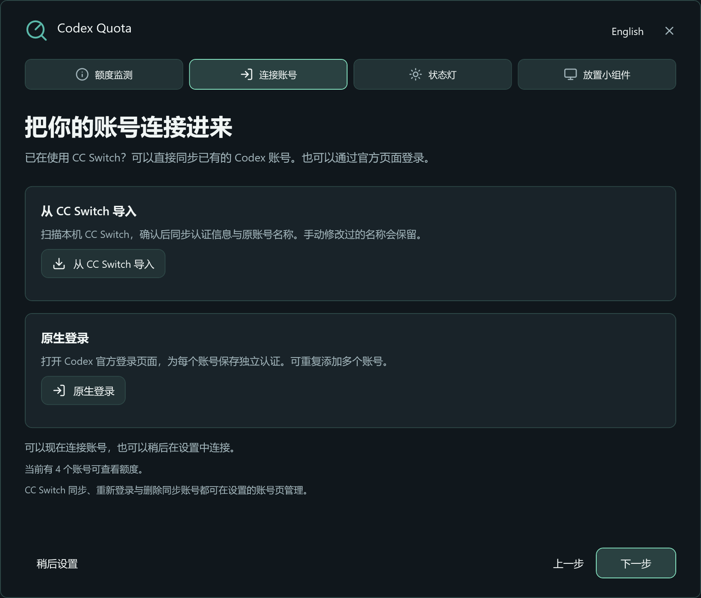
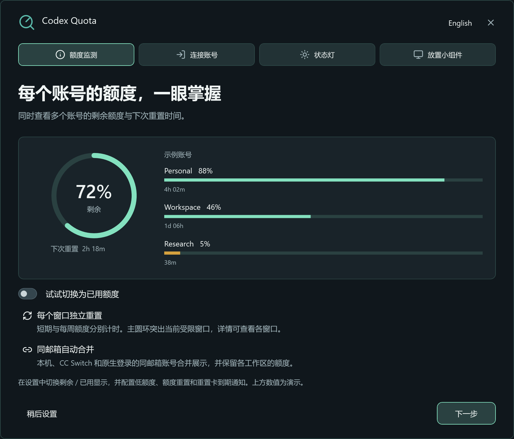
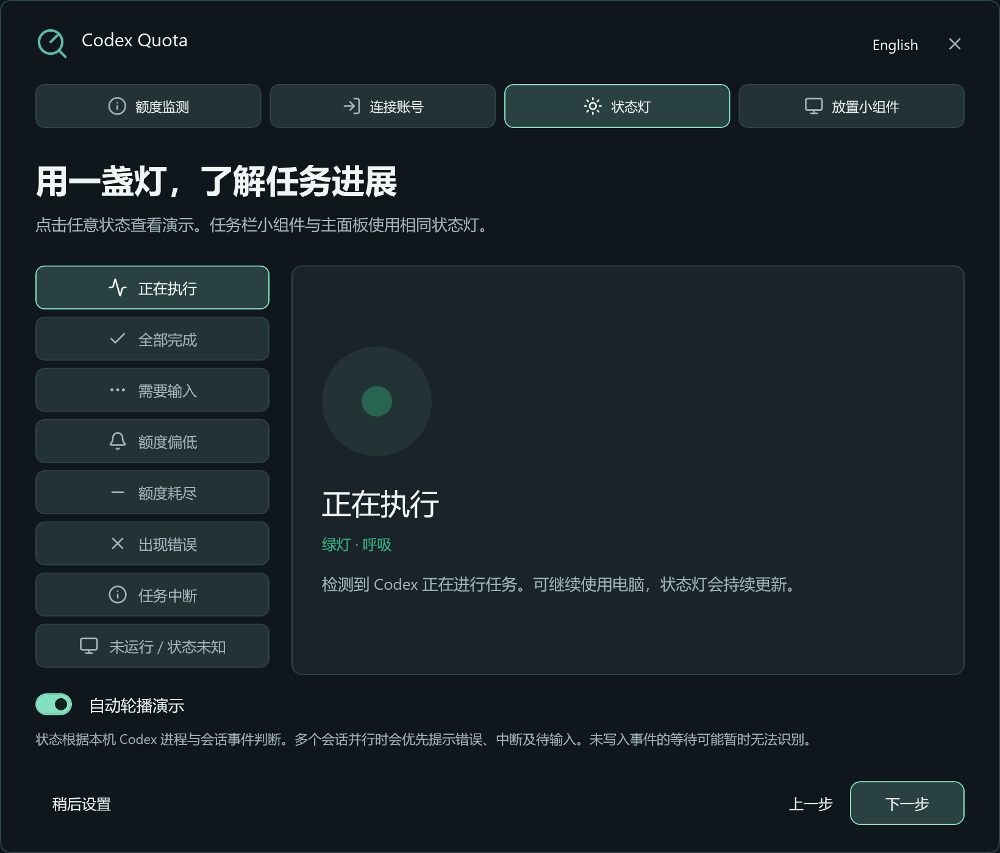
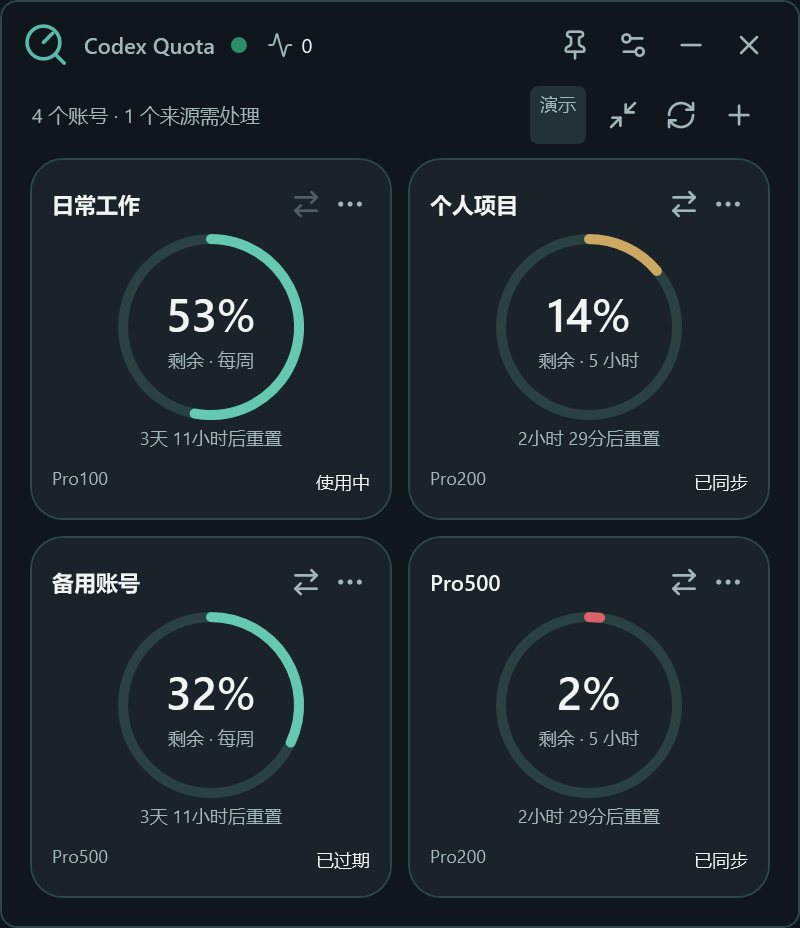
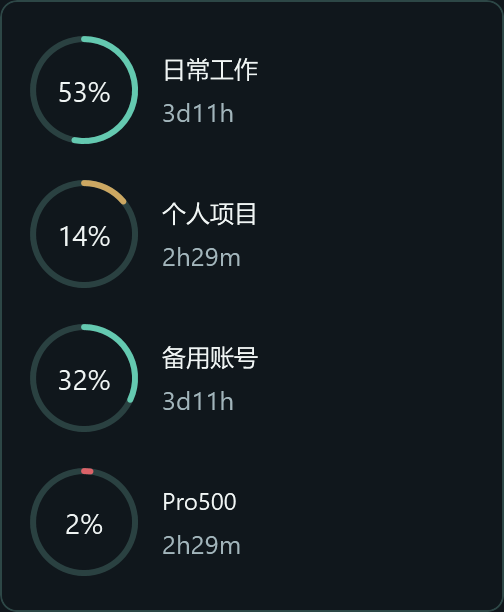
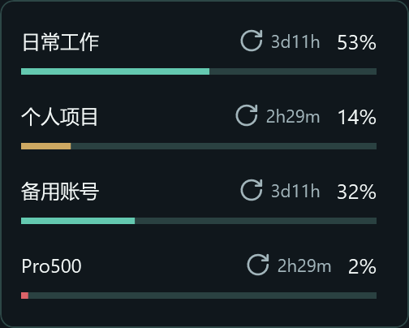
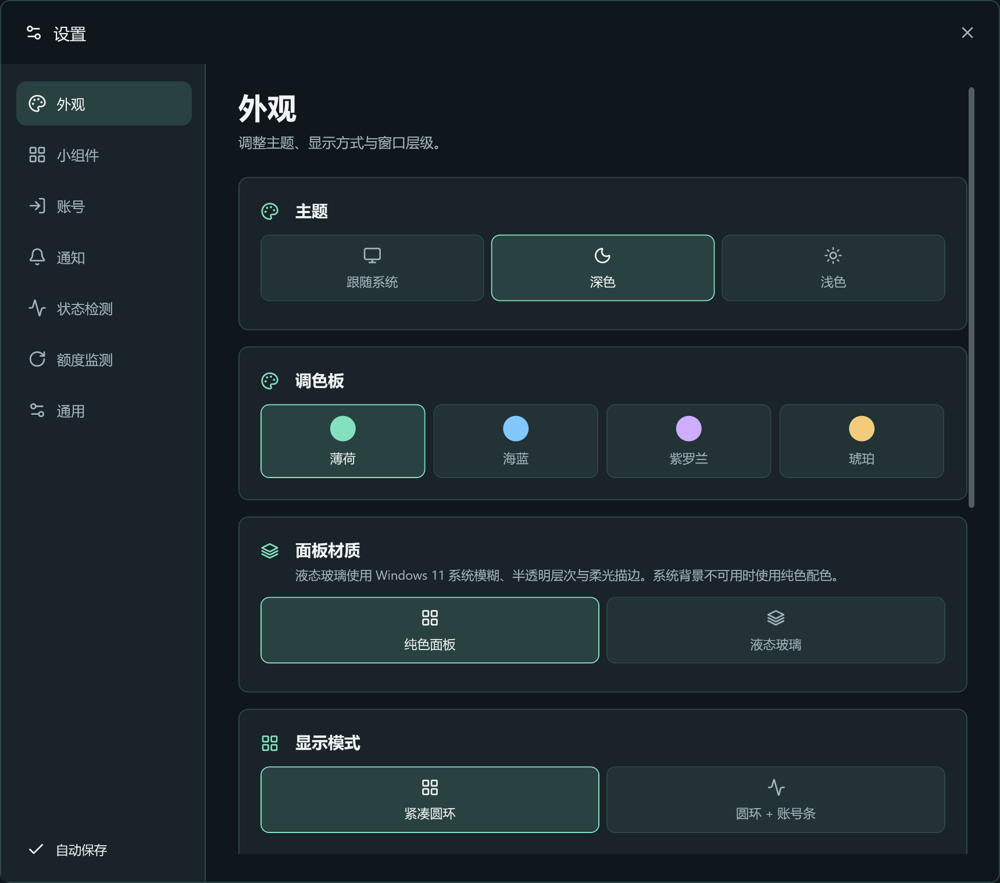
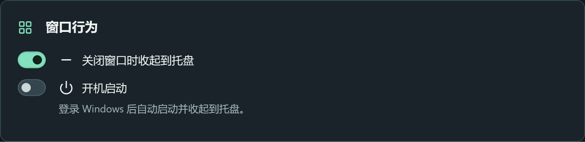
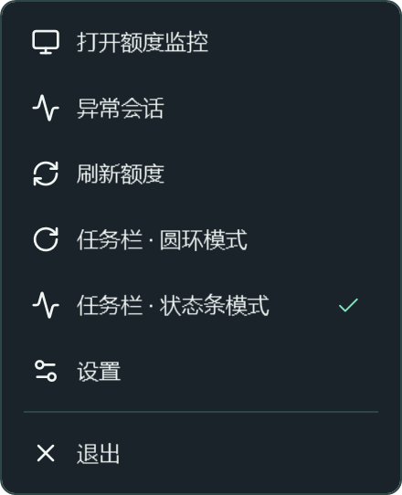

# CodexQuota

**简体中文** · [English](README.en.md)

Windows 上的 Codex 多账号额度监控工具。通过交互式导览连接账号、查看额度与重置时间，支持 **CC Switch 一键导入账号**和 **Codex 原生登录**。

[下载 2.0 正式版](https://github.com/IcebearHound/CodexQuota/releases/tag/v2.0.0) · [更新记录](CHANGELOG.md)

## 跟随导览开始

下载 Windows x64 便携版 ZIP，解压后运行 `CodexQuota.exe`。便携版已包含 .NET 运行时，额度查询使用本机已安装的 Codex 程序。

首次运行会打开交互式导览，章节可自由切换。之后可从「设置 → 通用 → 使用导览与说明书」再次打开。以下界面图使用演示账号。

### 连接账号

- **CC Switch 一键导入**。选择「从 CC Switch 导入」，扫描本机已有的 Codex 账号，确认后同步认证和原始名称。
- **原生登录**。选择「原生登录」，通过 Codex 官方浏览器页面完成认证。每个账号独立保存认证，可重复添加多个账号。

导入、重新同步及账号管理也可在「设置 → 账号」完成。



### 看懂额度与重置时间

导览用交互式示例展示剩余额度和已用额度。短期与每周窗口分别计时，主圆环突出当前受限窗口。同邮箱账号自动合并显示，各工作区的额度继续独立呈现。



### 识别任务状态

点击状态示例查看执行、完成、等待输入、低额度、耗尽、错误、中断及离线状态。运行时点击异常状态灯可打开异常会话列表，支持单条忽略和全部忽略，已归档会话退出统计。



### 放到任务栏

在导览的小组件章节开启任务栏显示。单击小组件常驻展开账号面板，再次单击收起，悬停可临时预览。右键菜单可切换圆环或状态条，任务栏与主面板的布局分别保存。


## 日常使用

主面板集中显示账号、额度和重置时间。点击精简模式按钮可缩小面板，双击、按 Esc 或通过右键菜单返回完整界面。



| 精简圆环 | 精简状态条 |
| --- | --- |
|  |  |

## 配色与液态玻璃

「设置 → 外观」提供薄荷、海蓝、紫罗兰和琥珀四种预设配色，可搭配跟随系统、深色或浅色主题。液态玻璃使用 Windows 11 系统背景模糊、半透明层次和柔光描边，主面板、导览和浮窗会即时切换。

系统背景不可用或使用桌面嵌入模式时，面板采用相应的纯色配色。

<details>
<summary>查看外观设置与常用选项</summary>



「设置 → 通用 → 窗口行为」可开启开机启动，登录 Windows 后在托盘后台运行。支持额度与重置卡通知、中英文、账号名称编辑和隐私显示。





</details>

## 数据与升级

账号和设置保存在 `%LOCALAPPDATA%\CodexQuotaWidget`，用量通过本机 Codex app-server 查询。升级前退出旧版额度监控，再运行新版。

<details>
<summary>构建与验证</summary>

需要 Windows 和 .NET 10 SDK。`global.json` 指定 SDK 10.0.100，并允许同系列较新功能版本。

```powershell
dotnet build Quota.Desktop -c Release
dotnet run --project Quota.Tests -c Release
dotnet run --project Quota.Presentation.Tests -c Release
```

实窗回归使用可交互的 Windows 桌面与独立数据目录。

```powershell
$fixture = Join-Path ([IO.Path]::GetTempPath()) ('CodexQuota-' + [guid]::NewGuid().ToString('N'))
dotnet run --project Quota.Presentation.Tests -c Release -- --guide-smoke --demo --guide --data-dir $fixture
```

发布自包含单文件版本。

```powershell
dotnet publish Quota.Desktop -c Release -r win-x64 --self-contained true -p:PublishSingleFile=true -p:EnableCompressionInSingleFile=true -p:IncludeNativeLibrariesForSelfExtract=true -p:DebugType=None -o artifacts/win-x64
```

源码包含 `Quota.WidgetProvider` Windows Widgets Board 提供程序及 `Publish-Widgets.ps1`，采用独立的 MSIX 注册流程。

</details>

## 许可

[MIT License](LICENSE)。Lucide 图标许可位于 [Assets/lucide/LICENSE](Quota.Desktop/Assets/lucide/LICENSE)，便携版附带 .NET 运行时许可及第三方声明。
